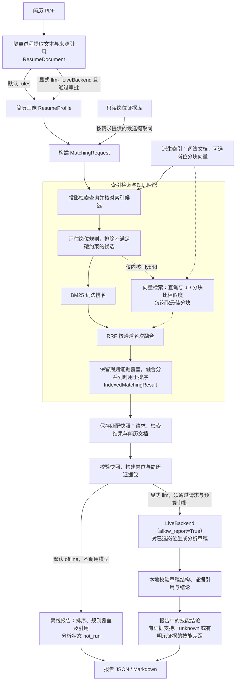

# JobRadar V1 核心流程

实线表示 V1 HTTP 接口已实现的路径，边上的模式和审批条件仍适用。虚线是检索内核可用、但 V1 HTTP 接口未开放的向量通道。启用 LiveBackend 不会打开该通道。

- **画像与匹配。** [`api_v1_resumes.py`](../src/job_radar/api_v1_resumes.py) 隔离提取 PDF，默认走规则画像。[`api_v1_matching.py`](../src/job_radar/api_v1_matching.py) 校验画像证据，从只读证据库取出显式指定的候选，调用索引匹配；HTTP 请求 `hybrid` 会被拒绝。
- **BM25、向量与 RRF。** [`rag_engine.py`](../src/job_radar/rag_engine.py) 在检索前评估规则。默认 `bm25_rules` 只把 BM25 名次交给 RRF；内核 `hybrid` 需要兼容的向量索引和显式注入的 embedding 客户端，才会将 [`dense_hits`](../src/job_radar/rag_index.py) 产出的向量名次一起送入融合。没有 LLM 重排。
- **报告与技能差距。** [`api_v1_reports.py`](../src/job_radar/api_v1_reports.py) 从已完成的匹配快照生成报告，不重新检索。Live 分析草稿在本地通过 [`report_analysis.py`](../src/job_radar/report_analysis.py) 校验后，结论才随报告呈现。若结论仅是材料未提及某技能的使用经历，则标记 `unknown`；明确的 `skill_gap / explicit_gap` 要引用简历中的直接否定证据，不能把缺证据当作不会。离线报告不生成这些模型结论。

启动与验证方式见 [README](../README.md#快速上手) 和 [Docker 启动说明](DOCKER.md)。
